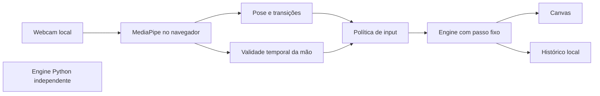

# Evolução do Flappy Bird com Gestos

Data: 17/10/2026 (America/Fortaleza). Base local: `4740e99`, branch `feat/gesture-modes-e2e`.

## Objetivo e contexto

Completar a experiência gestual sem reconstruir capacidades já existentes. A `main` pública consultada estava em `49787b8`; o checkout local já possuía Hand Landmarker, domínio testável, física em passo fixo, dois modos, preferências e telemetria local. Essas entregas anteriores foram preservadas e não são atribuídas a esta rodada.

O pedido inicial de preparar um prompt foi ampliado pelo anexo que autoriza execução local. Não houve autorização para push, merge, publicação, cobrança ou mudanças em serviços externos. Os arquivos sincronizados do projeto ChatGPT são referências somente de leitura.

## Arquitetura preservada

`src/features/game/domain` continua sem DOM/React; `gesture/infrastructure` gerencia câmera/modelo; `gesture/ui` integra o ciclo de vida; `game-demo.tsx` coordena a tela. A engine Python permanece local. Não há servidor de vídeo nem necessidade de banco de dados.

## Implementação desta rodada

- Sessão com câmera ligada aceita apenas flaps por gesto; clique, toque, teclado e reinício manual ficam bloqueados. A demo manual continua disponível com a câmera desligada.
- Ausência de landmarks por 600 ms ou congelamento do vídeo pausa a partida. Fechar e abrir a mão retoma; voltar a aparecer com a mão aberta não gera um flap antigo.
- Pausa manual permanece como controle de segurança. A retomada durante a sessão gestual usa um novo gesto.
- A permissão da câmera é resolvida antes do carregamento do modelo. Cancelar interrompe a espera e libera recursos que resolverem posteriormente.
- Callbacks de uma inicialização cancelada não substituem a sessão mais recente.
- Novos testes cobrem política de input, perda da mão, cancelamento, vídeo com falha e liberação idempotente.

## Plano, migração e custos

Mudanças incrementais nos módulos existentes, sem mudança no contrato da API ou no formato do histórico. Nenhuma dependência nova. Biblioteca e WASM seguem no carregamento sob demanda; o modelo continua dependendo do bucket oficial do Google.

Não foi introduzida obrigação de custo. Vercel/Actions continuam sujeitos às cotas da conta; nenhum serviço foi contratado ou configurado. Instalação limpa, build e testes devem preceder qualquer publicação. Manter os headers e validar câmera/modelo no preview autorizado; um health check não prova detecção gestual.

## Qualidade, segurança e limites

Resultados e comandos atuais estão em [VALIDATION_REPORT.md](VALIDATION_REPORT.md). Revisão direcionada a input, câmera, ciclo de vida e configurações existentes; não é certificação de segurança de todo o histórico Git ou de infraestrutura externa.

O E2E usa câmera sintética sem mão: confirma integração de câmera, modelo, loop e interface. Reconhecimento de uma mão humana em luz real permanece pendente. A precisão e a latência física não podem ser inferidas desses testes.

Pesquisa, decisões de licença e alternativas: [GITHUB_RESEARCH_AND_FEATURES.md](GITHUB_RESEARCH_AND_FEATURES.md). Prioridades e continuidade: [ROADMAP_AND_SKILLS.md](ROADMAP_AND_SKILLS.md). Histórico anterior: [docs/EVOLUTION.md](docs/EVOLUTION.md).
